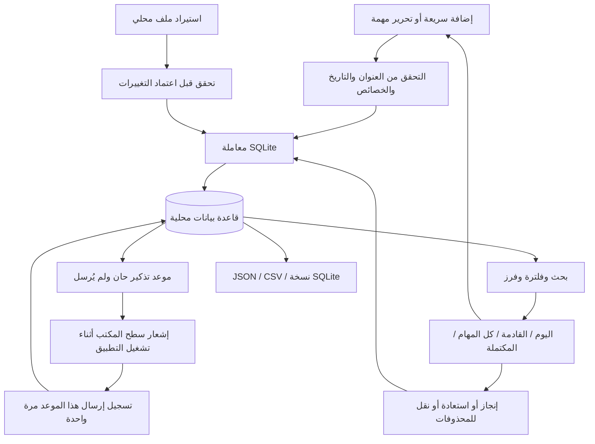

# DATA FLOW — نواة على Linux Mint

النطاق الأول: مهام بواجهة بسيطة. أُضيف قسم المصاريف الشهرية والشارت بطلب المستخدم في الإصدار 0.2، دون مساحة صفحات أو مشاريع معقدة.

## النموذج المستقل

المهمة سجل مستقل بمعرّف ثابت وعنوان ووصف وحالة وأولوية وتاريخ استحقاق.
ترتبط بقائمة اختيارية، وتملك وسومًا ومهام فرعية وتكرارًا وتذكيرًا اختياريين.
العروض استعلامات على البيانات نفسها، وليست نسخًا منفصلة من المهمة.

## حدود المسؤوليات

| الملف | المسؤولية |
|---|---|
| `nawa/ui.py` | واجهة GTK عربية وإنجليزية، اختيار العرض، التحرير، عرض النتائج والأخطاء |
| `nawa/store.py` | التحقق، SQL، الفرز والبحث، التكرار، المحذوفات، الاستيراد والتصدير |
| `nawa/reminders.py` | فحص التذكيرات أثناء التشغيل وإرسال Gio.Notification |
| `nawa/__main__.py` | بدء التطبيق وواجهة الطرفية |
| `install.py` | تثبيت ملفات البرنامج والمشغّل، مع فصل بيانات المستخدم |

## ما يعنيه الحفظ

SQLite هو مصدر الحقيقة. إعادة بناء قائمة GTK بعد التعديل تقرأ البيانات المحفوظة.
المعاملات تمنع حفظ نصف استيراد إذا كانت البيانات غير صالحة. النسخ المتسق عبر واجهة SQLite
يأخذ التغييرات الموجودة في WAL، بخلاف نسخ ملف `.sqlite3` وحده أثناء التشغيل.
التصدير الكامل مناسب للنسخ الاحتياطي؛ CSV يفقد بطبيعته بعض العلاقات.

إكمال مهمة متكررة يُنشئ الموعد التالي حسب قاعدة التكرار. تغيير العرض أو البحث لا يعدّل المهمة.
الحذف الأول ينقلها للمحذوفات، والإزالة النهائية إجراء منفصل مؤكد في الواجهة.

## المصاريف الشهرية — الإصدار 0.2

`ExpenseDialog` → تحقق من المبلغ والتاريخ → تحويل المبلغ إلى عدد صحيح من الهلالات →
جدول `expenses` في SQLite → تجميع بحسب الشهر/التصنيف/اليوم → بطاقات الإجمالي وشارت Cairo.
جدول `expense_budgets` يربط كل شهر بسقف اختياري. الحسابات تتم بوحدات صحيحة،
وتُستخدم القيم الكسرية فقط لرسم النسب والإحداثيات.

الحذف يضع علامة `deleted_at` ويُستبعد من الشارت، ويمكن التراجع عن آخر حذف.
CSV يصدر العمليات النشطة للشهر؛ JSON 2 وSQLite يشملان السجلات والميزانيات.
استيراد قديم بالإصدار 1 يبقى مدعومًا، والمصاريف في JSON 2 تُتحقق داخل معاملة الاستيراد نفسها.
لا تُستبدل التعديلات المحلية عند تعارض معرّفات النسخ المستوردة.

## اللغة والعملة — الإصدار 0.3

`i18n.py` يحتوي ترجمة نصوص الواجهة إلى الإنجليزية. تبقى أسماء القوائم وعناوين المهام والملاحظات كما أدخلها المستخدم.
`preferences.py` يحفظ اختيار اللغة والعملة وسعر التحويل في ملف JSON مستقل باستخدام استبدال ذري.
التغيير من الإعدادات يعيد بناء الواجهة في النافذة نفسها مع حفظ المسودات والفلاتر والشهر الحالي وإمكانية التراجع عن الحذف.

تبقى قاعدة المصاريف بالهلالات الصحيحة وبنفس مخطط الإصدار 2. عرض الدولار يقسم المبلغ على السعر المحدد،
وإدخاله يضرب بالسعر ويقرّب إلى أقرب هللة باستخدام Decimal وROUND_HALF_UP. حفظ مبلغ ظاهر دون تغييره
يحافظ على القيمة الأصلية، حتى لو اختلفت دقة التقريب في عرض الدولار. الرسوم والميزانيات وCSV تستخدم عملة العرض.
JSON وSQLite يحفظان القيم الأصلية بالريال؛ ملف الإعدادات منفصل ويُنسخ بصورة مستقلة عند الحاجة.
