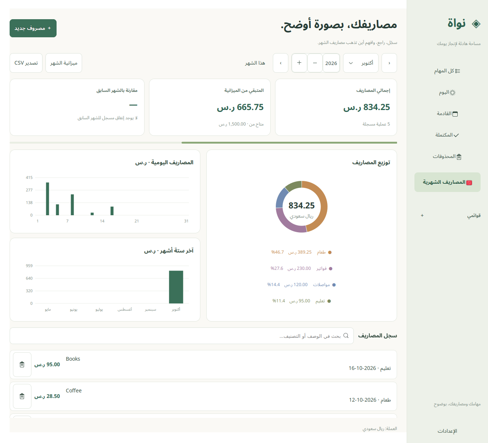
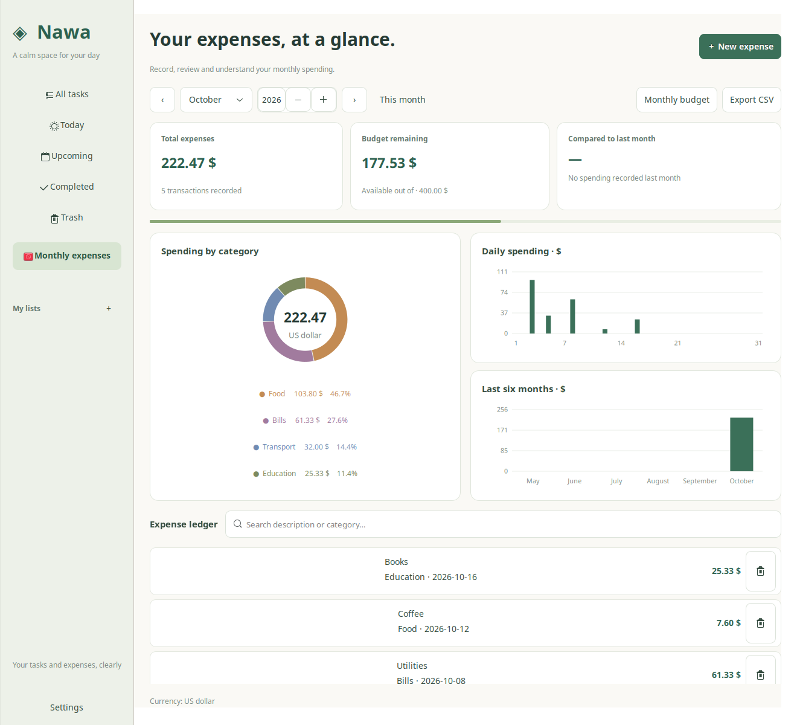

# Nawa · نواة

A calm workspace for your tasks and monthly expenses. Built with Python, GTK 3 and Cairo for Linux and Windows.

مساحة هادئة لتنظيم مهامك ومتابعة مصاريفك الشهرية، بواجهة عربية أو إنجليزية.



## الميزات

- مهام مع أولويات ومواعيد ووسوم وقوائم وخطوات فرعية وتكرار وتذكيرات.
- عروض لكل المهام، اليوم، القادمة، المكتملة والمحذوفات.
- مصاريف شهرية وميزانيات ورسوم للتصنيفات والإنفاق اليومي وآخر ستة أشهر.
- بحث وفلترة وتصدير CSV، مع نسخ احتياطي واستيراد JSON وSQLite.
- **الإعدادات:** العربية أو الإنجليزية، مع تغيير اتجاه الواجهة مباشرة وحفظ الاختيار.
- **العملة:** الريال السعودي أو الدولار الأمريكي، وتُطبّق على الإدخال والميزانية والرسوم وتصدير المصاريف.

اختيار العملة لا يعيد كتابة سجلاتك. تُحفظ المبالغ بالهلالات الصحيحة، ويُحوّل العرض والإدخال بالدولار
وفق سعر الإعدادات: **٣٫٧٥ ريال لكل دولار افتراضيًا**. يمكنك تعديل السعر؛ لا يتحدث تلقائيًا.
تصدير JSON وSQLite يحفظ القيم الأصلية بالريال. CSV للمصاريف يستخدم عملة العرض المختارة.

## Windows 10 / 11 · 64-bit

حمّل **Setup.exe** أو **Portable.zip** من [الإصدارات](https://github.com/o8bo/nawa/releases).
المثبّت يضيف اختصارًا لقائمة ابدأ. للنسخة المحمولة: فك الضغط بالكامل ثم افتح **Nawa.exe**.
Python ومكتبات الواجهة مضمنة؛ لا تحتاج إلى تثبيتها.
الملفات التنفيذية غير موقعة رقميًا.

تُحفظ البيانات والإعدادات في `%LOCALAPPDATA%\Nawa`، وتبقى عند إزالة البرنامج.
تظهر التذكيرات داخل نواة أثناء تشغيله؛ إغلاق النافذة ينهي التطبيق ويوقف التذكيرات.
يدعم الإصدار نفس خيارات العربية والإنجليزية والريال والدولار.

Download **Setup.exe** or **Portable.zip** from [Releases](https://github.com/o8bo/nawa/releases).
Extract the entire portable ZIP before opening **Nawa.exe**. Python and GTK are bundled.
Data and preferences live in `%LOCALAPPDATA%\Nawa` and survive uninstalling the app.
Windows reminders appear inside the running app; closing its window exits Nawa.
Build scripts and package notices are in [windows](windows).

## التشغيل والتثبيت على Linux

على Linux Mint 22 أو Ubuntu مع Python 3 وGTK 3 وPyGObject:

```bash
sudo apt-get install python3 python3-gi python3-gi-cairo gir1.2-gtk-3.0
bash launch.sh
```

لإضافة التطبيق إلى قائمة البرامج:

```bash
python3 install.py
```

لترقية تثبيت سابق، أغلق التطبيق أولًا ثم نفّذ:

```bash
python3 install.py --update
```

يحتفظ المثبّت بنسخة البرنامج السابق ويفصل بيانات المستخدم عن ملفات البرنامج.
شريط النظام يستخدم AyatanaAppIndicator3 عند توفره. التذكيرات تعمل أثناء تشغيل التطبيق،
وتتوقف عند الخروج الكامل. الاختصارات: `Ctrl+N` للإضافة و`Ctrl+F` للبحث.

## البيانات

قاعدة البيانات الافتراضية: `~/.local/share/nawa/tasks.sqlite3`.
الإعدادات: `~/.config/nawa/preferences.json`.
يمكن تغيير الجذور عبر `XDG_DATA_HOME` و`XDG_CONFIG_HOME`، أو تحديد `NAWA_DB_PATH` و`NAWA_SETTINGS_PATH`.
قاعدة بديلة عبر `--data` تحصل على ملف إعدادات مجاور لها عند غياب `NAWA_SETTINGS_PATH`.

لنسخة احتياطية كاملة، استخدم JSON أو SQLite من قائمة التطبيق؛ CSV مخصص للتبادل الجدولي.
الاستيراد يدمج بحسب المعرّفات ويبلغ عن التعارضات. لاستعادة SQLite، أغلق التطبيق واحفظ نسخة
من قاعدة البيانات الحالية وملفاتها المساعدة قبل استبدالها بلقطة النسخ الاحتياطي.
الإصدار 0.3 يحافظ على توافق بيانات الإصدار 0.2 واستيراد JSON الأقدم.

## English

Choose **Settings → Language → English** and select **Saudi riyal** or **US dollar** independently.
Changes apply immediately, including navigation, dialogs, expense categories and charts.
Your own task titles, lists and notes are preserved.

Dollar display and entry use the configurable **SAR per USD** rate (default **3.75**).
This rate does not update automatically. Stored amounts stay in integer SAR minor units;
JSON/SQLite backups retain these original values. Monthly expense CSV uses the chosen display currency.
Unchanged expense edits preserve the original amount exactly, including rounding differences.

Run `bash launch.sh`, or install a desktop launcher with `python3 install.py`.
For an existing installation, close Nawa and use `python3 install.py --update`.
Reminders require Nawa to remain running. Timezone defaults to `Asia/Riyadh`; override `TZ` if needed.



## Development

Python 3.10+ with the system GTK bindings. No pip dependencies are required.

```bash
python3 -m unittest discover -p 'test_*.py' -v
# Include native UI tests in a headless environment:
xvfb-run -a python3 -m unittest discover -p 'test_*.py' -v
```

Native UI tests are skipped when no display is available. GitHub Actions runs them under Xvfb.

```bash
bash launch.sh --add 'Review the weekly plan'
bash launch.sh --list
bash launch.sh --export tasks-backup.json
bash launch.sh --import-json tasks-backup.json
bash launch.sh --data /tmp/nawa-demo.sqlite3 --expenses
```

See [DATA_FLOW.md](DATA_FLOW.md) for the storage and interface architecture.
Licensed under [MIT](LICENSE).
